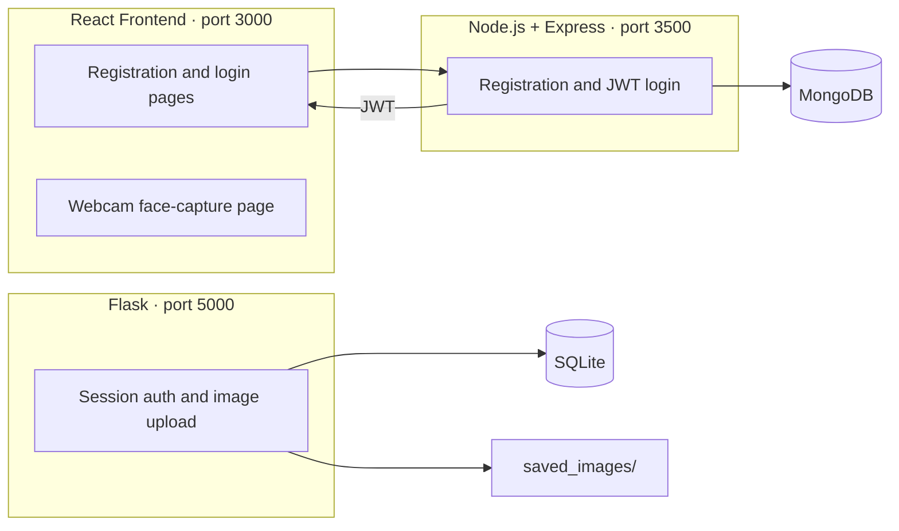

# Interactive Agent Reinforced with Emotion-Enabled Facial Authentication

A web application that combines user authentication with browser-based facial image capture for emotion-enabled authentication workflows.

The application includes a React frontend, a Node.js + MongoDB authentication API, and a Flask image/session service. Users can create an account, sign in, open the webcam capture page, and store facial images through the image-upload API.


---

## Abstract

Facial authentication provides a convenient way to verify a user's identity, and facial emotion cues can make digital interactions more personalised. This project is designed around that idea and delivers a facial authentication and image-capture web application: users register an account, sign in, and capture a facial image directly from their browser webcam.

The system is built with a React frontend and two backend services. A Node.js/Express API backed by MongoDB handles account registration and JWT-based login, while a Flask API backed by SQLite provides session-based authentication and stores uploaded facial images. The frontend uses React Router, Bootstrap, Axios, and `react-webcam` to deliver a responsive authentication and image-capture experience.

---

## Features

- **User registration** with full name, username, email, mobile number, and password.
- **User login and logout** through the Flask session API.
- **JWT-based login** through the Node.js authentication API.
- **Webcam face capture** with retake support using `react-webcam`.
- **Base64 image upload** that persists captures as timestamped `.jpg` files.
- **MongoDB user storage** through Mongoose.
- **SQLite user storage** for the Flask authentication flow.
- **CORS-enabled APIs** for communication with the React development server.
- **Responsive UI** built with React Bootstrap and React Router.

---

## Architecture



The application provides two backend options:

- `BackEnd/server.js` — Node.js/Express with MongoDB and JWT authentication.
- `BackEnd/app.py` — Flask with SQLite, server-side sessions, and image storage.

The React frontend uses the Node API for registration and login, while the Flask API provides session-based authentication and the image-upload endpoint.

---

## Tech Stack

### Frontend

| Technology | Purpose |
| --- | --- |
| React 18 | Component-based UI |
| React Router 6 | Client-side routing (`/register`, `/login`, `/home`, `/register_face`) |
| React Bootstrap / Bootstrap 5 | Layout, forms, buttons, and responsive styling |
| `react-webcam` | Browser webcam access and image capture |
| Axios | HTTP requests to the backend APIs |

### Backend

| Technology | Purpose |
| --- | --- |
| Node.js + Express | Authentication API on port `3500` |
| Mongoose + MongoDB | User persistence for the Node API |
| `jsonwebtoken` | JWT creation |
| `dotenv` | Environment configuration |
| Flask | Authentication and image API on port `5000` |
| Flask-CORS | Cross-origin requests from the React app |
| Flask-Session | Server-side session storage |
| SQLite | Local user store (`BackEnd/static/users_db.db`) |
| Python `base64` | Decoding uploaded data URLs |

---

## Repository Layout

```text
.
├── BackEnd/
│   ├── app.py                  # Flask auth, session, and image-upload API
│   ├── server.js               # Express + MongoDB + JWT auth API
│   ├── package.json            # Node dependencies and start script
│   ├── .env                    # MONGO_URL and SECRET_KEY
│   ├── index.html              # Static placeholder page
│   └── static/
│       └── users_db.db         # SQLite database used by app.py
├── FrontEnd/
│   ├── front_end/              # Main React application
│   │   ├── public/
│   │   └── src/
│   │       ├── App.js          # Route definitions
│   │       ├── Loginpage.js    # Login form
│   │       ├── RegistrationPage.js
│   │       ├── Registerface.js # Webcam capture page
│   │       ├── Home.js         # Authenticated landing page
│   │       ├── sidebar.js      # Bootstrap off-canvas component
│   │       └── index.css       # Global styling
│   ├── package.json
│   └── node_modules/
├── saved_images/               # Captured/uploaded face images
├── LICENSE                     # Apache License 2.0
└── README.md
```

> `FrontEnd/node_modules` is currently committed to the repository. It is listed in `.gitignore`, but tracked files remain tracked until they are explicitly removed with `git rm -r --cached FrontEnd/node_modules`.

---

## Getting Started

### Prerequisites

- **Node.js 18+** and npm
- **Python 3.9+** and pip
- A **MongoDB** database (MongoDB Atlas or a local instance) for the Node API
- A browser with webcam access for the face-capture page

Clone the repository:

```bash
git clone https://github.com/phani-x507/-Interactive-Agent-Reinforced-with-Emotion-Enabled-Facial-Authentication.git
cd -- "-Interactive-Agent-Reinforced-with-Emotion-Enabled-Facial-Authentication"
```

### 1. Start the React frontend

```bash
cd FrontEnd/front_end
npm install
npm start
```

Open <http://localhost:3000>. The available routes are:

| Route | Page |
| --- | --- |
| `/register` | Account registration form |
| `/login` | Login form |
| `/home` | Authenticated landing page |
| `/register_face` | Webcam face capture |

### 2. Start the Node/Express auth API

```bash
cd BackEnd
npm install
```

Create `BackEnd/.env` with your own values:

```env
MONGO_URL=mongodb+srv://<user>:<password>@<cluster>/<database>
SECRET_KEY=<a-long-random-secret>
```

Then start the server:

```bash
npm start
```

The API listens on <http://localhost:3500>. `npm start` uses `nodemon`, so it restarts when files change.

### 3. Start the Flask API

From the `BackEnd` directory (the paths in `app.py` are relative to the working directory):

```bash
cd BackEnd
python -m venv .venv
source .venv/bin/activate        # Windows: .venv\Scripts\activate
pip install flask flask-cors flask-session
python app.py
```

The Flask API listens on <http://127.0.0.1:5000>. It uses the SQLite database at `static/users_db.db` with a `logindata` table. A minimal schema is:

```sql
CREATE TABLE IF NOT EXISTS logindata (
    id INTEGER PRIMARY KEY AUTOINCREMENT,
    uname TEXT NOT NULL,
    pass TEXT NOT NULL,
    fullname TEXT,
    mobileno TEXT,
    email TEXT
);
```

Uploaded images are written to a `saved_images/` directory relative to the process working directory, with filenames based on the current timestamp.

---

## API Reference

### Node/Express API — `http://localhost:3500`

#### `POST /register_user`

Creates a MongoDB user document.

```json
{
  "uname": "jane",
  "pass": "example-password",
  "fullname": "Jane Doe",
  "mobileno": "9999999999",
  "email": "jane@example.com"
}
```

#### `POST /login_user`

Validates credentials and returns a signed JWT on success.

```json
{
  "uname": "jane",
  "pass": "example-password"
}
```

Responses:

- `200` — JWT string
- `404` — `{ "msg": "Not Found" }`
- `200` — `{ "msg": "Incorrect Details" }`

The login endpoint returns the JWT directly in the response body.

#### `GET /`

Health/placeholder response: `Hello World!`

---

### Flask API — `http://127.0.0.1:5000`

#### `POST /upload_image`

Accepts a base64 JPEG data URL and saves it under `saved_images/`.

```json
{
  "data": "data:image/jpeg;base64,/9j/4AAQSkZJRgABAQ..."
}
```

Response:

```json
{
  "message": "Image saved successfully!",
  "image_path": "saved_images/20240821001930.jpg"
}
```

#### `POST /login_details`

```json
{
  "uname": "jane",
  "pass": "example-password"
}
```

On success, stores the user ID in the Flask session and returns:

```json
{
  "fullname": "Jane Doe",
  "id": 1,
  "is_loggedin": true,
  "response": "exist"
}
```

#### `POST /register_user`

```json
{
  "uname": "jane",
  "pass": "example-password",
  "fullname": "Jane Doe",
  "mobileno": "9999999999",
  "email": "jane@example.com"
}
```

Returns `{ "response": "done" }` on success.

#### `POST /logout`

Clears the session user ID and returns `{ "msg": "Successfull" }`.

---

## Application Flow

1. A new user opens `/register` and submits their account details.
2. The React form sends the details to the Node API (`/register_user`), which stores them in MongoDB. The Flask + SQLite API provides the same registration flow.
3. The user signs in through `/login`. The Node API validates the credentials and returns a JWT.
4. The user visits `/register_face`, where `react-webcam` captures a JPEG screenshot with retake support.
5. Images submitted to the Flask `/upload_image` endpoint are stored in `saved_images/` as timestamped files.

---

## Security & Privacy

The application handles account credentials and facial images, so deployments should follow these practices:

- Store passwords using a strong password hash such as bcrypt or Argon2.
- Use parameterised SQL queries to prevent SQL injection.
- Keep `.env` files out of version control and rotate any exposed credentials.
- Treat facial images as sensitive biometric data: obtain consent, restrict access, define a retention policy, and delete images when they are no longer needed.
- Restrict CORS origins and disable debug mode in deployed environments.
- Production face authentication should include liveness detection to resist photo and replay attacks.

---

## Contributing

1. Fork the repository.
2. Create a feature branch: `git checkout -b feature/my-change`.
3. Make and test your changes.
4. Commit with a clear message.
5. Open a pull request describing the change and any setup steps.

Please avoid committing `.env` files, database files containing real user data, or captured face images.

---

## License

This project is licensed under the **Apache License 2.0**. See [LICENSE](LICENSE) for the full text.

---

## Acknowledgements

Developed by the project contributors:

- [phani-x507](https://github.com/phani-x507)
- [snehith1815](https://github.com/snehith1815)
- [MohammadSohail786](https://github.com/MohammadSohail786)

Built with React, Bootstrap, Flask, Express, MongoDB, and SQLite.
